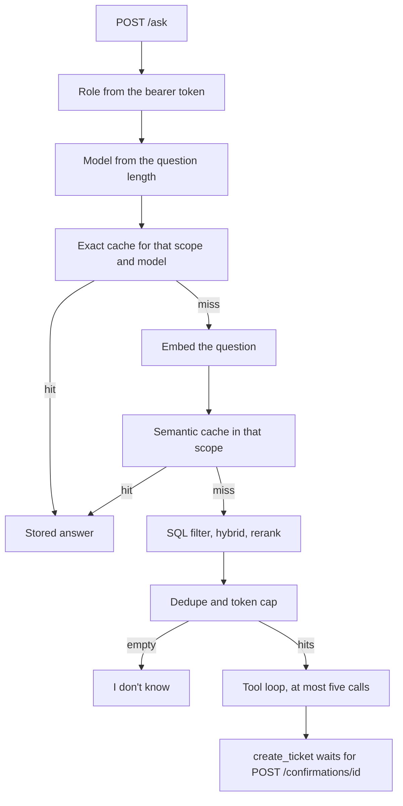

# Demo

Synthetic Northline Telecom support agent. The numbers in the README are the script output already pasted there. This page is the order a stranger runs, and what each command is for.

## Reproduce the tables

From the repository root, with the virtualenv active:

```powershell
docker compose up -d db
make migrate
make ingest
make eval
make cost
```

`docker compose up -d db` publishes Postgres on host port 5433. `make migrate`, `make ingest`, `make eval`, and `make cost` run on the host and use that database. They do not run inside the API container.

`make eval` prints the Phase 4 retrieval table. The README paste is that stdout. Answerable `n` is 42, the corpus size is 280, and `k` is 5. Rerank against hybrid is 4 wins, 1 loss (`b02`), and 37 ties.

`make cost` prints the Phase 9 cost table. It does not call Gemini. The token counts are the script's assumptions (`token_source=assumed`, `gemini_calls=0`). `n` is 100: 30 exact hits, 5 semantic hits, 20 cheap bills, and 45 generator bills.

`make test` and `make lint` are the checks that do not need a Gemini key.

## Call the API

`make up` builds the image and starts Postgres, the mock CRM, and the API. Swagger is at `http://localhost:8000/docs`. The same database is the one the host migrated, so run `make migrate` and `make ingest` before the first search.

To serve the working tree without a rebuild:

```powershell
python -m uvicorn supportdesk.main:app --port 8000
```

The CRM, only if you want ticket reads against the seed ticket:

```powershell
python -m uvicorn supportdesk.crm_server:app --port 8001
```

On Windows, `curl` is an alias for `Invoke-WebRequest`. The examples below use `Invoke-RestMethod`.

```powershell
Invoke-RestMethod http://localhost:8000/health
```

That returns `status` = `ok`.

```powershell
$token = python -m supportdesk.token customer
$headers = @{ Authorization = "Bearer $token" }
Invoke-RestMethod -Method Post -Uri http://localhost:8000/search -Headers $headers -ContentType "application/json" -Body '{"query":"FINANCE_CANARY_7K2M"}'
```

A customer search must not contain `FINANCE_CANARY_7K2M`. `tests/test_rbac.py` is that check: the customer body omits the canary, the finance token's search on those rows includes it, and a `role` field in the JSON is 422. The live API uses the same SQL filter. This page does not add a new retrieval score.

```powershell
Invoke-RestMethod -Method Post -Uri http://localhost:8000/ask -Headers $headers -ContentType "application/json" -Body '{"query":"hello"}'
```

With an empty `GEMINI_API_KEY`, that ask is HTTP 503 and `detail` is `generator is not configured`. Search still runs. Putting a key in `.env` is what allows `POST /ask` to call Gemini. This repository has not made that call, so there is no recorded answer text.

After one search, `http://localhost:8000/metrics` includes `supportdesk_requests_total`. The JSON log line on the API process includes the trace id, stage times, retrieved ids, and scores. It does not include chunk text.

## Request path

`POST /ask` reads the role from the bearer token, then chooses a model from the normalized length. At most 80 characters uses `gemini-2.5-flash`. A longer question uses `gemini-3.8-flash`.

The exact cache is the hash of that question, the model id, and the sorted access scope. The SQL lookup repeats the scope. A miss embeds the question and accepts the nearest cached embedding in the same scope and model when the cosine distance is at or under 0.05. A hit returns the stored answer and does not call the model.

A miss retrieves with `access_level = ANY(...)`, fuses the vector and keyword lists, and reranks. Compression then dedupes and stops at 2000 tokens. An empty list returns `I don't know` and does not call the model. Otherwise the manual tool loop runs, at most five model calls. `create_ticket` stops with `confirmation_required`. `POST /confirmations/{id}` with the same role is the write to the mock CRM. The seed ticket is `TCK-1001`.



## Left unmeasured

Faithfulness, answer relevance, and refusal accuracy need a Gemini call. None has been made. `u01`–`u10` are still blank. The semantic distance and the cost token counts were not fit on the gold set. Those limits are listed in the README.
